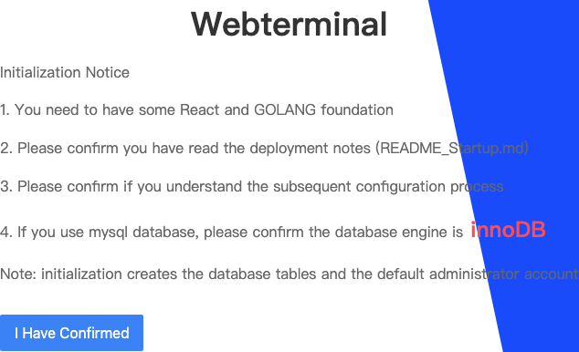
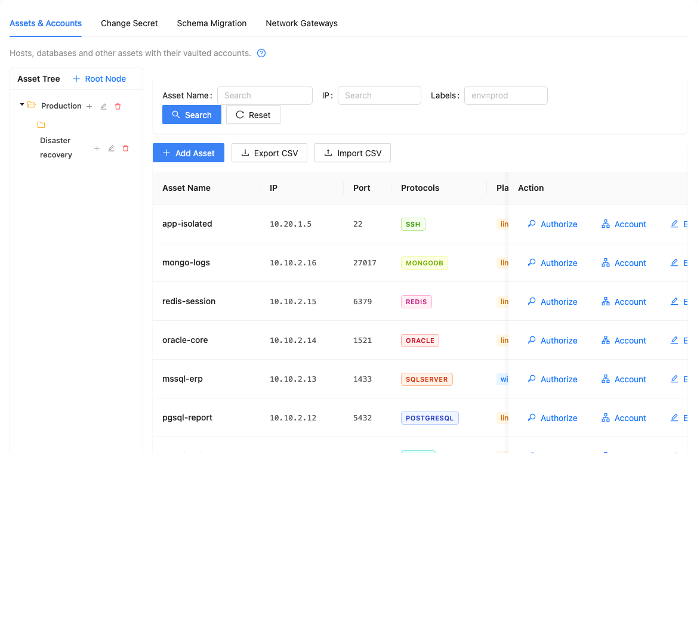
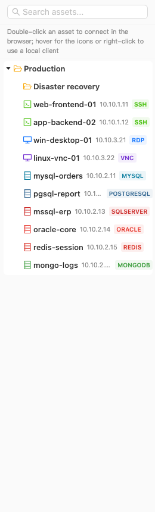
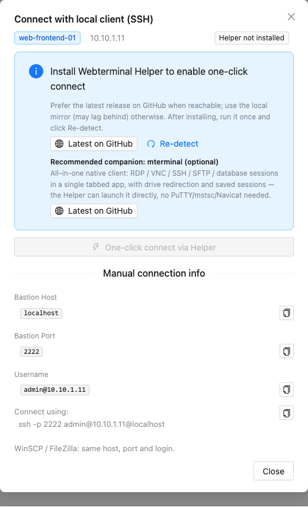
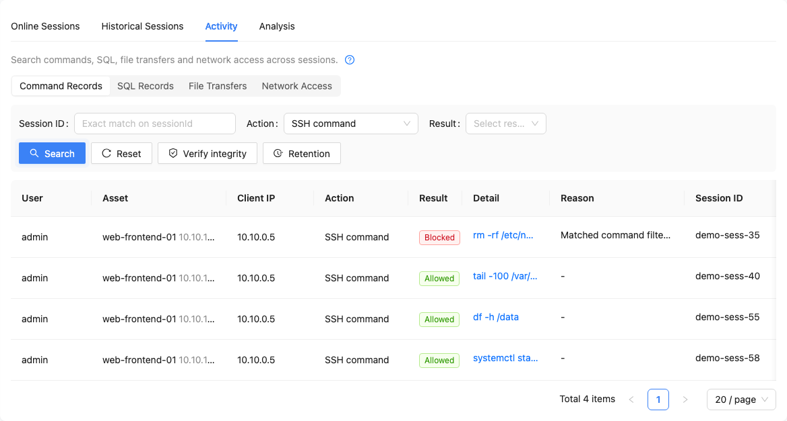
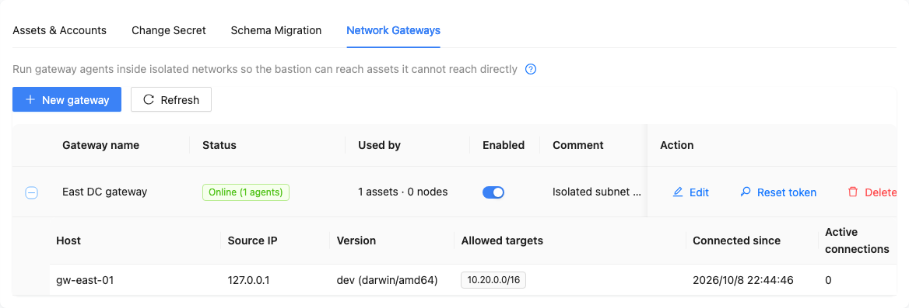
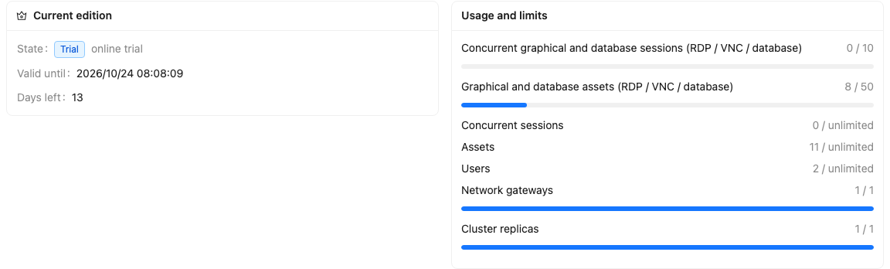

# Webterminal — Open-Source Bastion Host & Access Audit Platform

[](README_zh.md)
[](https://hub.docker.com/r/webterminal/webterminal)

Webterminal is an all-in-one privileged access platform: unified asset onboarding, authorization control, session auditing and operation replay. Run SSH / RDP / VNC / database operations directly in the browser, or connect with native clients (ssh, mstsc, mysql, navicat…) through the built-in protocol proxies.

> 📌 **Use the 1.0 Docker image** (this document). The Python/Django source in this repository is the legacy implementation — see [README_LEGACY.md](README_LEGACY.md).

## Release 1.0

1.0 is a ground-up rewrite: Go backend + React frontend, shipped as a **single all-in-one container** — the webterminal server, nginx and SQLite in one image, no external dependencies (no Redis; single-node deployments fall back to in-memory state). One tag serves both amd64 and arm64.

### Features

- **Protocols**: SSH / SFTP / Telnet, RDP, VNC, WinRM, MySQL / PostgreSQL / SQL Server / Oracle / Redis / MongoDB, Kubernetes
- **Two ways in**: web terminals (xterm, in-browser RDP/VNC desktops, browser file transfer) + native-client proxies (local ssh / mstsc / database clients / one-click helper launch)
- **Authorization model**: principal (user / group / department) → asset/node × account × protocol × action (connect, upload, download, clipboard, port forwarding…), with validity windows, approvals and policies
- **Audit**: full session history, SSH/RDP/VNC recording & replay, command filtering/blocking, database SQL filtering
- **Network gateways**: isolated segments are reached through lightweight `gw-*` agents over encrypted tunnels; asset routing resolves asset → node → direct
- **Operations**: password change/rotation, WinRM scripts & job center, published apps (RemoteApp), command review
- **Security by design**: vaulted credentials, one-time connection tokens, host-fingerprint-bound licenses, non-root container

## Quick Start

```bash
docker run -d --name webterminal --restart unless-stopped \
  -p 443:443 -p 80:80 \
  -p 2222:2222 -p 3389:3389 \
  -p 13306:13306 -p 15432:15432 -p 11433:11433 -p 11521:11521 \
  -p 16379:16379 -p 37017:37017 \
  -v webterminal-data:/data \
  webterminal/webterminal:1.0
```

Open `https://<host-ip>` (port 80 redirects to 443; a self-signed certificate is generated on first start) and finish the init wizard to set the admin password. After initialization, sign in as **`admin`** with the password you set in the wizard. 443 carries all web-side functionality; 2222/3389 and the database ports are the native-client proxies — keep the ones you use.



**On Linux hosts, also mount the host identity files** (used for online trial registration / license binding):

```bash
  -v /etc/machine-id:/host/machine-id:ro \
  -v /sys/class/dmi/id/product_uuid:/host/product_uuid:ro
```

### Ports

| Port | Purpose | Required |
|---|---|---|
| 443 | Console HTTPS (web terminals / API / file transfer) | yes |
| 80 | 301 redirect to 443 only | recommended |
| 2222 | Native SSH / SFTP proxy | optional |
| 3389 | Native RDP proxy | optional |
| 13306 / 15432 / 11433 / 11521 | MySQL / PostgreSQL / SQL Server / Oracle proxies | optional |
| 16379 / 37017 | Redis / MongoDB proxies | optional |

Map only what you use. When host-published ports differ from the container ports, declare the public endpoint via `BASTION_PUBLIC_HOST` / `BASTION_SSH_PROXY_PORT` / `BASTION_RDP_PROXY_PORT` (otherwise issued `wterm://` URLs point at the wrong ports), e.g. `-p 12222:2222 -e BASTION_SSH_PROXY_PORT=12222`.

## Screenshots

| Asset center | Workspace |
|---|---|
|  |  |

| Native client access | Session audit |
|---|---|
|  |  |

| Gateways | Licensing |
|---|---|
|  |  |

## Trial & Licensing

A default install runs the **Community** edition: 50 restricted-protocol assets (RDP / VNC / databases), 5 concurrent restricted sessions, 1 replica, 1 gateway — SSH-type assets are not limited. A **15-day online trial** unlocks all Enterprise features:

- **Online trial** (recommended): on a Linux host with the `/host` identity mounts above, open *System Settings → License → Register trial online* — done in one click.
- **Offline trial**: on Docker Desktop (macOS/Windows) or hosts without a stable fingerprint, use *License → Generate request code* to obtain a `WTR2.` code, send it to the vendor, and upload the returned `WTS1.` license file on the same page.
- **Commercial license**: Enterprise licenses ship as a serial + license file bound to the installation (asset count, session concurrency, replicas, gateways per contract).

The license page shows current state, expiry and per-feature availability; on expiry or limit breach, security-policy features remain read-only and auditing keeps working.

## Data & Upgrades

- All state lives in the `/data` volume: SQLite, configuration, TLS certificates, SSH host key, session recordings, logs. Backing up = archiving this volume.
- Upgrade: `docker pull` the new tag and recreate the container; data carries over.
- Replace the HTTPS certificate by overwriting `/data/ssl/server.crt` / `server.key` and restarting.

## Notes

- The container runs as a non-root user; native proxy ports start listening only after the init wizard completes.
- Gateway agents (Linux systemd/OpenRC, Windows service) are installed with a one-line command generated on the *Gateways* page, with SHA-256 verification and host-key pinning.
- **Version 1.0 is recommended.** The source in this repository is the earlier Django implementation (0.x) and is no longer maintained; its deployment/usage docs live in [README_LEGACY.md](README_LEGACY.md) and [docs/](docs/).
