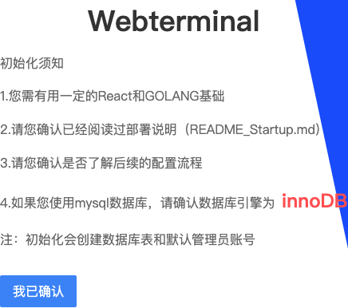
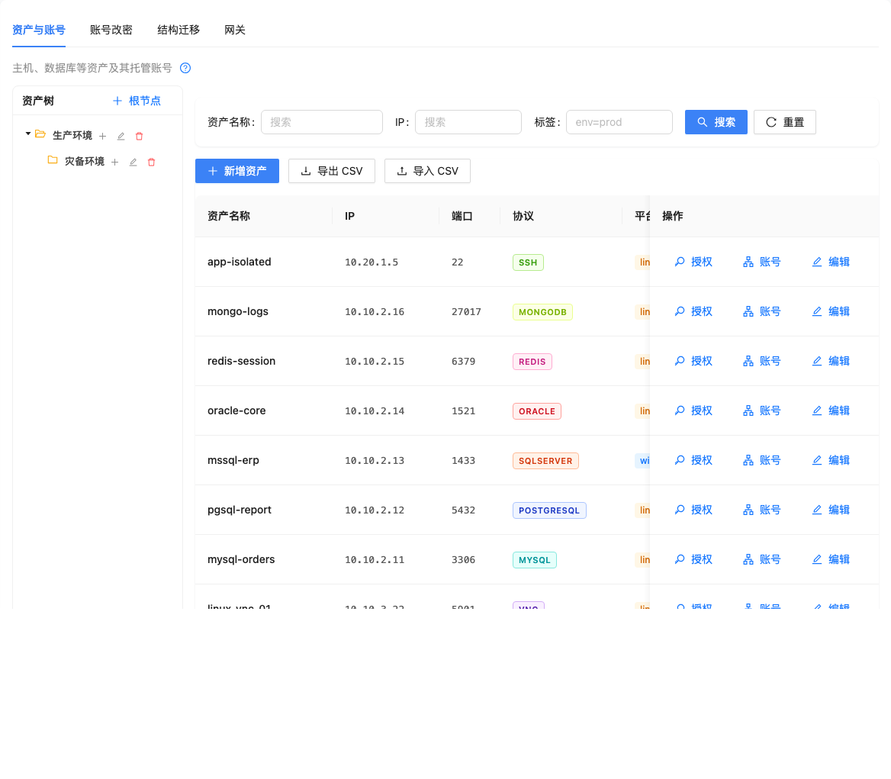
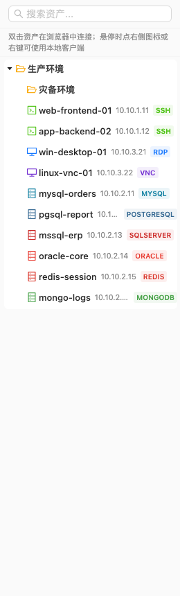
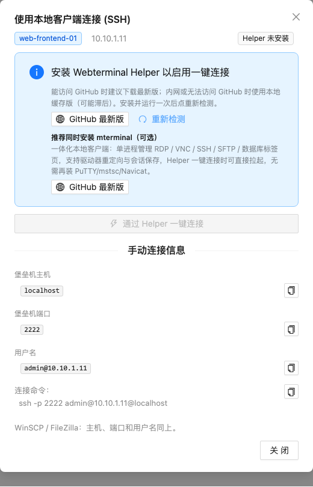
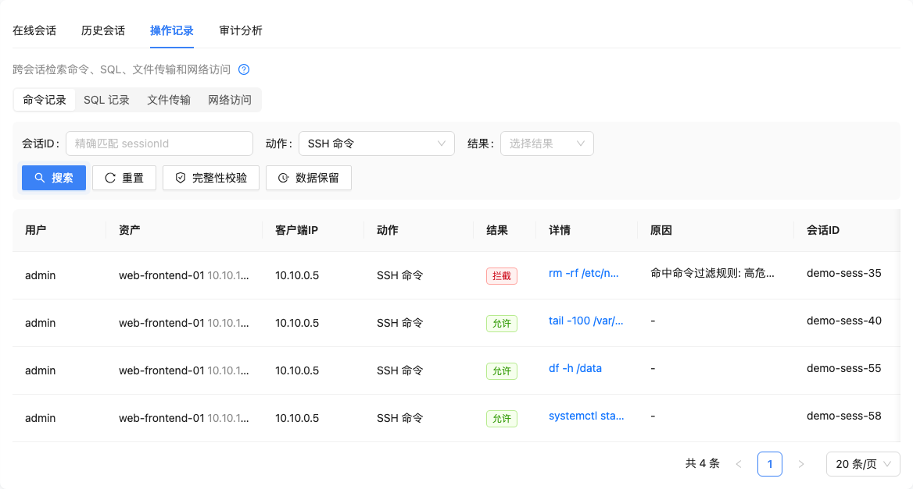
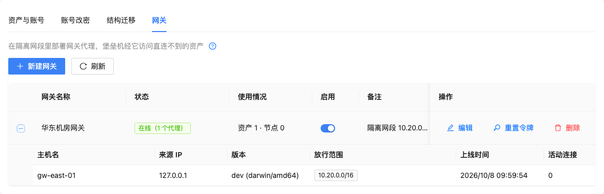
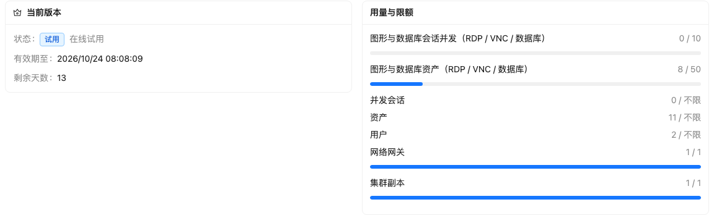

# Webterminal — 开源堡垒机 / 运维审计平台

[](README.md)
[](https://hub.docker.com/r/webterminal/webterminal)

Webterminal 是一体化特权访问管理平台：统一的资产接入、授权控制、会话审计与操作回放。浏览器里即可完成 SSH / RDP / VNC / 数据库运维，也可通过原生客户端（ssh、mstsc、mysql、navicat…）经内置协议代理直连。

> 📌 **推荐使用 1.0 Docker 镜像**（本文档）。仓库内的 Python/Django 源码为旧版实现，文档见 [README_LEGACY.md](README_LEGACY.md)。

## 1.0 版本

1.0 是全新重构版本：Go 后端 + React 前端，以**单容器 All-in-One 镜像**发布——一个容器内含 webterminal 服务 + nginx + SQLite，无外部依赖（不含 Redis，单机全部走内存兜底），amd64 与 arm64 同 tag 多架构分发。

### 功能一览

- **协议接入**：SSH / SFTP / Telnet、RDP、VNC、WinRM、MySQL / PostgreSQL / SQL Server / Oracle / Redis / MongoDB、Kubernetes
- **两种使用方式**：网页终端（xterm、网页 RDP/VNC 桌面、浏览器文件传输）+ 原生客户端代理（本地 ssh / mstsc / 数据库客户端 / helper 一键拉起）
- **授权模型**：主体（用户/用户组/部门）→ 资产/节点 × 账号 × 协议 × 动作（连接、上传、下载、剪贴板、端口转发…），支持有效期、审批与策略
- **审计**：全量会话记录、SSH/RDP/VNC 操作录像回放、命令过滤与阻断、数据库 SQL 过滤
- **网络网关**：被隔离网段通过轻量 agent（`gw-*`）经加密隧道转发，资产路由按 资产 → 节点 → 直连 解析
- **运维自动化**：改密/轮换、WinRM 脚本与作业中心、发布应用（RemoteApp）、命令复核
- **安全设计**：凭据加密保管、一次性连接令牌、主机指纹绑定许可、非 root 容器运行

## 快速开始

```bash
docker run -d --name webterminal --restart unless-stopped \
  -p 443:443 -p 80:80 \
  -p 2222:2222 -p 3389:3389 \
  -p 13306:13306 -p 15432:15432 -p 11433:11433 -p 11521:11521 \
  -p 16379:16379 -p 37017:37017 \
  -v webterminal-data:/data \
  webterminal/webterminal:1.0
```

打开 `https://<主机IP>`（80 自动跳转 443，自签名证书首次启动自动生成），进入初始化向导设置管理员密码即可使用。初始化完成后登录账号为 **`admin`**，密码即向导中设置的密码。443 承载网页端全部功能；2222/3389/数据库端口是原生客户端代理，按需保留。



**Linux 主机建议增加主机指纹挂载**（用于在线登记试用/许可绑定）：

```bash
  -v /etc/machine-id:/host/machine-id:ro \
  -v /sys/class/dmi/id/product_uuid:/host/product_uuid:ro
```

### 端口说明

| 端口 | 用途 | 必需 |
|---|---|---|
| 443 | 控制台 HTTPS（网页终端 / API / 文件传输） | 是 |
| 80 | 仅 301 跳转 443 | 建议 |
| 2222 | SSH / SFTP 原生代理 | 按需 |
| 3389 | RDP 原生代理 | 按需 |
| 13306 / 15432 / 11433 / 11521 | MySQL / PostgreSQL / SQL Server / Oracle 代理 | 按需 |
| 16379 / 37017 | Redis / MongoDB 代理 | 按需 |

只映射用到的端口即可。宿主机映射端口与容器端口不一致时，用 `BASTION_PUBLIC_HOST` / `BASTION_SSH_PROXY_PORT` / `BASTION_RDP_PROXY_PORT` 声明对外地址（否则签发的 `wterm://` 连接串会指向错误端口），例如 `-p 12222:2222 -e BASTION_SSH_PROXY_PORT=12222`。

## 界面预览

| 资产中心 | 工作台 |
|---|---|
|  |  |

| 本地客户端连接 | 会话审计 |
|---|---|
|  |  |

| 网关 | 授权许可 |
|---|---|
|  |  |

## 试用与授权

默认安装为**社区版**：受限协议（RDP / VNC / 数据库类）50 资产、5 并发会话，单副本、1 网关，SSH 类资产不限。提供**15 天在线试用**解锁全部企业功能：

- **在线登记试用**（推荐）：Linux 主机挂载上述 `/host` 指纹文件后，控制台「系统设置 → 授权许可 → 在线登记试用」一键完成，15 天全功能。
- **离线试用**：macOS / Windows Docker Desktop 或无稳定指纹的环境，「授权许可 → 生成申请码」得到 `WTR2.` 申请码，联系厂商换取 `WTS1.` 授权文件后在同页面上传。
- **正式授权**：企业版签发序列号 + 授权文件，绑定安装实例（资产规模、会话并发、副本数、网关数按需约定）。

授权页实时显示当前许可状态、到期时间与各功能可用性；到期或超限时安全策略类功能保持只读不失效，运维审计不中断。

## 数据与升级

- 全部状态在 `/data` 卷：SQLite、配置、TLS 证书、SSH host key、会话录像、日志。备份即打包该卷。
- 升级：`docker pull` 新 tag 后重建容器即可，数据自动沿用。
- 替换正式 HTTPS 证书：覆盖 `/data/ssl/server.crt` / `server.key` 后重启。

## 说明

- 容器内以非 root 用户运行；原生代理端口在初始化完成后才开始监听。
- 网络网关 agent（Linux systemd / OpenRC、Windows 服务）在控制台「网关」页生成一行安装命令，自带 SHA-256 校验与主机密钥锁定。
- **推荐使用 1.0**。本仓库源码为早期 Django 实现（0.x），已停止维护；旧版部署与使用文档见 [README_LEGACY.md](README_LEGACY.md) 和 [docs/](docs/)。
